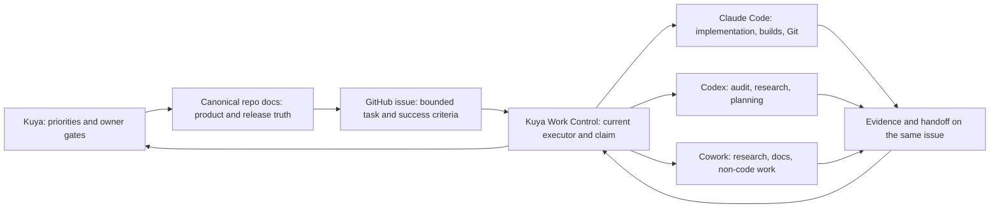

# Kuya Work Control

> **Live execution board:** [Kuya Work Control](https://github.com/users/Pootytxng/projects/1)
>
> This file is stable operating law, not a task list. Never copy live assignments, statuses,
> deadlines, or session logs into it.

## What this controls

The GitHub Project coordinates who is doing what across Claude Code, Codex, Cowork, VS Code, and
future tools. It prevents two sessions from writing the same area without making repository
Markdown carry another stale status ledger.

It does **not** replace Compy's existing sources of product truth:

- `docs/RELEASE_STATE.md` remains authoritative for gates, builds, artifacts, and releases.
- `docs/BACKLOG.md` remains authoritative for product-work status and priority.
- `docs/OWNER_ACTION_CHECKLIST.md` remains authoritative for owner obligations.
- Code, commits, tests, receipts, and runtime evidence remain authoritative for implementation.

The Project holds only the live execution layer: current task, executor, claim, work location,
status, next action, and last verification.



## One source for each kind of truth

| Truth | Canonical home |
|---|---|
| Product priority and completion | `docs/BACKLOG.md` and the named product spec |
| Gates, artifacts, installed build, publication | `docs/RELEASE_STATE.md` and release receipts |
| Current executor, worktree, branch, status, next action | Kuya Work Control Project |
| Goal, scope, decisions, handoffs, evidence | One linked GitHub issue |
| Implementation | Commits and pull requests |
| Conversation context | Chat only; never authoritative |

Do not maintain a second status board in Markdown, chat, a VS Code note, or another tool.

## Roles

- **Claude Code** owns implementation, builds, tests, Git, and Compy's silent reinstall.
- **Codex** defaults to read-only audit, research, planning, and independent verification.
- **Cowork** owns research, documents, copy, design judgment, and review unless a task explicitly
  gives it a bounded write scope.
- **Kuya** owns gates, money, distribution, people, taste, security/system settings, secrets, and
  irreversible choices.

A tool name is not an ownership claim. Ownership belongs to one issue and one bounded scope.

### What "gate" means (clarified 2026-08-03)

A **gate** is a decision that reaches the outside world or cannot be walked back: publishing a
release, spending money, granting access, handling secrets, changing system settings, and product
or taste calls.

Routine Git operations are **not** gates. Committing, pushing a branch, opening a pull request, and
merging a green PR into `main` are ordinary execution — reversible, and invisible to users until a
release is cut and published. Do not park finished, gate-green work on Kuya for a merge decision;
merge it and report. Escalate on the release itself, not on the plumbing that precedes it.

## Claim before write

Before any file, Git, build, install, or system mutation:

1. Open or create the issue and confirm its goal and success criteria.
2. Check the Project for an overlapping **Active** item.
3. Verify the real repository, worktree folder, branch, dirty state, and relevant live processes.
4. Post the claim below on the issue and set the Project fields.
5. Only then begin the bounded work.

```text
### Ownership claim
- Lane:
- Executor/tool:
- Repository:
- Worktree folder:
- Branch:
- Write scope:
- Started:
- Claim expires: (default: 12 hours)
- Next action:
- Active build/install/helper processes: none | exact process and purpose
```

The minimum Project fields are `Lane`, `Worktree / branch`, `Next action`, `Claim expires`, and
`Last verified`. Use `Gate` whenever the next step enters owner territory.

## Collision rules

1. **One issue, one active write owner.** Reviewers may work read-only in parallel.
2. **One folder, one writer.** A different branch does not make concurrent writes in the same
   working folder safe.
3. **Overlapping scopes serialize.** The later session stays read-only or uses a truly separate
   worktree/clone and non-overlapping branch.
4. **Unknown means locked.** If a live session's exact folder or scope is unknown, treat every
   plausible folder as occupied until the session hands off or Kuya identifies it.
5. **Expiry is an alarm, not a takeover.** A 12-hour claim becoming stale never authorizes deleting,
   overwriting, resetting, stashing, killing, or taking over. Inspect the real worktree and processes,
   then post a takeover note with evidence.
6. **No silent process control.** Do not stop another tool's build, dev server, helper, editor, or
   session merely to clear a claim.
7. **No chat-only handoff.** A session is not handed off until the issue records evidence, remaining
   work, and the exact next action.

## Status meanings

- **Inbox** — captured, not yet shaped.
- **Ready** — clear next action, no unresolved gate, no active writer.
- **Active** — exactly one live write owner with a complete claim.
- **Review** — implementation has stopped; independent evidence is pending.
- **Needs Kuya** — only Kuya can decide or perform the next step.
- **Blocked** — progress is impossible without an external change.
- **Done** — named evidence exists and no required work remains.

Closing an issue means Done. Reopening returns it to Ready. Do not close an issue merely because a
session ended, a test passed, or a partial slice shipped.

## Handoff and takeover

Every session that touched a task ends with this comment:

```text
### Handoff
- Outcome:
- Files/commits/PR:
- Verification:
- Remaining work:
- Gates or owner actions:
- Worktree state:
- Active processes:
- Exact next action:
- Claim: released | renewed until <time>
```

For a stale or abandoned claim, the next session posts:

```text
### Verified takeover
- Previous claim:
- Worktree/process evidence checked:
- Preserved work:
- New executor/worktree/branch/scope:
- New expiry:
- Next action:
```

No takeover may use destructive Git or filesystem cleanup as its first move.

## Built-in anti-staleness

The Project uses GitHub's native workflows:

- new Sentinel issues enter **Inbox**;
- closed issues move to **Done**;
- reopened issues move to **Ready**;
- closed items older than four weeks are archived;
- focused views expose current work, lane ownership, owner gates, review, expired claims, and
  release/distribution gates.

A weekly Codex audit is read-only. It compares open `work-control` issues, their latest claim or
handoff, and local worktrees/processes, then reports missing or expired ownership. It never edits,
builds, installs, commits, pushes, stops processes, or contacts another session.

## Starting a future project

Use the same Project rather than creating one board per AI tool. In the new repository:

1. add an issue form that targets project `Pootytxng/1`;
2. link this operating law or copy its stable policy once;
3. keep that repository's own product/release truth in its own canonical docs;
4. use the same claim and handoff comments;
5. add only fields or views that represent a genuinely new kind of execution truth.

GitHub Free currently permits one auto-add workflow for this Project, so Sentinel uses it. Future
repositories add items through their issue form's `projects` field or manually; they do not require
another app, bot, or paid service.
