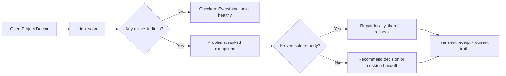
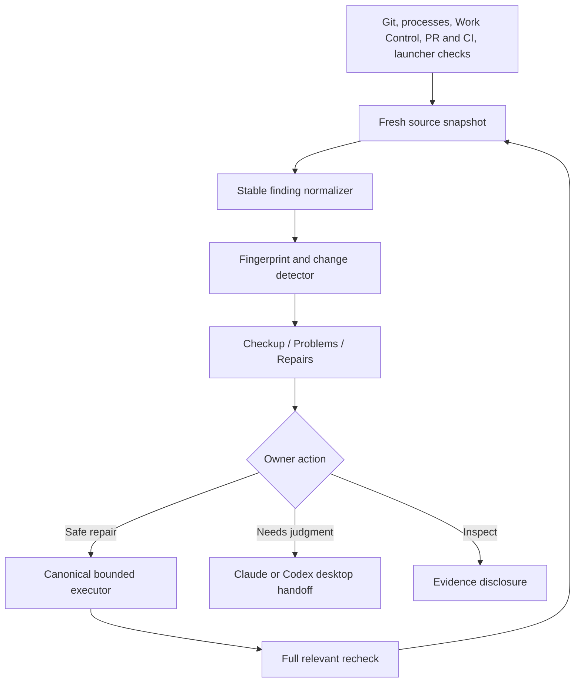

# Compy Project Doctor — zero-token design specification

**Status:** owner-approved direction; implementation not started<br>
**Decision date:** 2026-08-02<br>
**Evidence baseline:** `b80991b` (`main`, after PR #52)<br>
**Owner review gate:** this written specification must be accepted or redirected before an implementation plan is produced

## 1. Product decision

Compy Console stops trying to be the place where normal work and conversations happen. Its primary
job becomes **Project Doctor**: show whether the owner's projects are healthy, surface only conditions
that need attention, recommend one plain-language response, perform narrowly proven local repairs,
and hand genuinely ambiguous work to Claude Desktop or Codex Desktop.

The primary interface is exactly three views:

1. **Checkup** — "Is everything okay?"
2. **Problems** — "What needs attention?"
3. **Repairs** — "What can Compy safely do about it?"

Normal building, discussion, and conversation history remain in the native Claude and Codex desktop
apps. VS Code remains an optional specialist editor under Details; it is not a normal prerequisite.

This decision supersedes the primary **Continue / Start / History** owner journey introduced by
`3344176`. It does not authorize blindly deleting the underlying scanner, launcher, native-history,
or agent adapters. Those are retired or reused only after their replacement path is proven.

### Product promise

> Open Compy Doctor. If something is wrong, see the one thing that matters and the safest next move.
> If nothing is wrong, leave immediately.

### Non-goals

- A third chat client.
- A replacement for Claude Desktop, Codex Desktop, or their native history.
- A second Work Control board, release ledger, task database, or source of project truth.
- Background AI diagnosis, automatic prompts, or a token-consuming watchdog.
- A generic system-cleaner that guesses what files, branches, processes, or settings are safe.
- A place to expose every metric merely because the scanner can read it.

## 2. Confirmed current facts vs proposed behavior

Everything in the right column is design intent until implementation and live verification prove it.

| Area | Confirmed at `b80991b` | Proposed Project Doctor behavior |
|---|---|---|
| Primary journey | The Console leads with Continue, Start, and History. It reads native Claude/Codex session files and can stream agent turns. | Those three actions leave the primary UI. The Console leads with Checkup, Problems, and Repairs and hosts no ordinary conversation. |
| Source of truth | `tools/console/sources.mjs` reads host Git state, worktrees, branches, open PRs, CI meaning, Work Control items, folders, and lost-and-found conditions fresh. It says the Console owns no project state. | Preserve fresh reads. Normalize them into stable findings without creating a competing truth store. |
| Safety engine | `tools/entry` owns selection, worktree creation, claims, preflight, hook verification, context tiers, session-root checks, and the one proven hook repair. | Doctor actions call these canonical contracts. They do not reimplement or weaken them. |
| Refresh | The page loads a full state snapshot at startup and after selected actions. Its 60-second timer checks only whether a newer page revision exists. | A non-overlapping lightweight health scan runs on open and once per minute. Expensive checks remain explicit or slower-cadence. |
| Heavy verification | `/api/audit` runs the full local release verification only when requested. | Keep it explicit. It never becomes a background timer. |
| Agent cost | `/api/chat` can start Claude or Codex after an account check. A state snapshot also probes installed agent versions/status. | No automatic scanner may call `/api/chat`, an agent executable, or a model/API endpoint. Agent handoff is always an explicit owner click. |
| Desktop handoff | The current launcher is coupled to a VS Code bridge and Claude extension fallback. | Claude Desktop becomes the preferred Claude handoff. Codex Desktop becomes the preferred Codex handoff. VS Code moves behind optional Details. |
| Claude capability | Anthropic documents `claude://code/new?q=...&folder=...`; the app always asks the user to confirm a linked folder. | Use that official route, disclose the confirmation, and pass a concise prefilled repair brief. |
| Codex capability | Codex Desktop is installed and officially supports selecting a local folder/project. A supported folder-and-prompt deep-link contract has not been proven. | Use a capability adapter. Implement only a documented or live-proven desktop route; otherwise open Codex and copy the prepared brief without claiming automatic folder routing. |
| CI meaning | The current source layer distinguishes a real failing job from GitHub jobs that never started because of billing/spending state. | Preserve the distinction as separate finding codes. Never show "code failed" when no test executed. |

Official capability references: [Claude Desktop deep links](https://support.claude.com/en/articles/14729294-open-claude-desktop-with-a-link) and [Codex Desktop setup](https://openai.com/codex/get-started/).

## 3. Owner experience

### 3.1 Checkup

Checkup is the default and should answer the health question in one glance.

**Healthy state**

- One calm headline: **Everything looks healthy.**
- One subordinate line: last successful scan time and the scope covered.
- No fake zero cards, congratulatory copy, or article-length explanation.
- A single **Scan now** action.

**Attention state**

- One headline: **3 things need attention.**
- The highest-priority problem appears first with its recommended action.
- A compact project strip shows only projects with active findings; healthy projects are summarized,
  not expanded into dashboard furniture.
- An optional Details disclosure shows source reachability, scan age, and raw evidence.

### 3.2 Problems

Problems contains only unresolved current findings, ordered by consequence:

1. **Collision risk** — another writer, overlapping folder, conflicting active claims, or an unsafe
   process collision.
2. **Broken** — required workflow protection missing, inconsistent branch/folder state, a meaningful
   CI failure, or an unreachable canonical source that prevents a safe conclusion.
3. **Waiting on you** — a real owner decision, approval, or hands/eyes step.
4. **Advisory** — recoverable work, stale debris, or low-risk hygiene that is not blocking.

Every problem card uses the same four-part grammar:

- **What happened** — one sentence.
- **Why it matters** — one sentence in user-impact language.
- **Compy recommends** — one decision, not a menu.
- **Action** — exactly one primary action; secondary evidence stays under Details.

Example:

> **Two sessions point at the same folder.**<br>
> They could overwrite each other's work.<br>
> **Compy recommends:** return to the session that already owns it.<br>
> **Return to Claude**

### 3.3 Repairs

Repairs is not a list of every problem. It contains:

- **Ready to repair** — findings with a proven, bounded local remedy.
- **Needs a decision** — owner-gated findings with a recommended choice but no automatic mutation.
- **This session** — transient receipts for actions attempted since the page loaded: time, action,
  result, and recheck verdict.

The transient receipt list deliberately disappears on a full restart. Durable truth already lives in
Git, Work Control, issue handoffs, CI, and the existing project records. Project Doctor must not add a
second machine-generated history database that can disagree with them.

## 4. Information architecture and visual direction

The visual direction is a **calm instrument panel**, not a command center wall and not a chat app:

- one dominant status, then exceptions;
- dark restrained surfaces using the existing Compy token family;
- accent color for focus and identity, not decoration;
- red only for immediate collision/broken states, amber for owner attention, muted blue/gray for
  advisory, green only for a confirmed healthy result;
- no serif/editorial treatment, gamer RGB, neon glow fields, glass-card grids, or generic AI gradients;
- short labels, strong spatial hierarchy, and proof behind disclosure;
- motion only to show a state transition: scan, finding changed, repair running, recheck complete;
- full keyboard operation, visible focus, semantic headings, live-region announcements, and reduced-
  motion behavior.



## 5. Architecture

### 5.1 Principle: canonical readers, one normalizer, bounded executors

Project Doctor is a presentation and orchestration layer over existing truth. It consists of six
separable units:

1. **Source readers** — reuse `tools/console/sources.mjs` and `tools/entry` contracts.
2. **Scanner** — schedules source groups without overlapping runs.
3. **Finding normalizer** — converts structured source facts into stable finding codes.
4. **Resolution playbook** — maps a code plus structured facts to copy, authority, and one action.
5. **Action executor** — calls an allowlisted canonical action and always rechecks afterward.
6. **Desktop handoff adapter** — prepares a brief and opens a proven native app route only on click.



### 5.2 Finding contract

The normalizer emits structured data. Copy is rendered from codes and fields; raw error text is
evidence, never the routing mechanism.

```ts
type DoctorFinding = {
  code: FindingCode;
  fingerprint: string;
  project: string;
  scope: string;
  priority: "collision" | "broken" | "owner" | "advisory";
  state: "new" | "worsened" | "unchanged" | "improved";
  summary: string;
  impact: string;
  recommendation: string;
  action: DoctorAction;
  authority: "read" | "safe-local" | "owner" | "agent" | "external";
  evidence: EvidenceRef[];
  observedAt: string;
};
```

`fingerprint` is built from stable identity fields such as code, canonical folder, branch, issue, PR,
or process owner. It must never depend on prose. A copy edit cannot create a new problem; two distinct
folders cannot collapse into one.

### 5.3 Stable initial finding codes

| Code | Priority | Meaning |
|---|---|---|
| `WORKTREE_MULTI_WRITER` | Collision | Structured evidence says two live writers or claims target one folder. |
| `PROCESS_COLLISION` | Collision | A live build/install/agent process conflicts with the proposed action. |
| `BOARD_FOLDER_COLLISION` | Collision | Multiple Active board items name the same folder. |
| `DIRTY_WORKTREE` | Broken | Modified, staged, untracked, stashed, or otherwise unsaved state prevents a safe automated action. |
| `DIVERGED_BRANCH` | Broken | Local and upstream history disagree; no automatic rebase/reset/merge is safe. |
| `MISSING_CANONICAL_HOOKS` | Broken | Registered, canonical hooks are absent and the existing verifier can prove the condition. |
| `FOREIGN_HOOK_OR_OVERLAY` | Broken | The configuration points outside the owned canonical location or cannot prove ownership. |
| `CLAIM_EXPIRED` | Owner | A claim is stale; expiry is an alarm, never takeover authority. |
| `OWNER_DECISION` | Owner | Work is intentionally waiting at a Kuya gate. |
| `WAITING_EXTERNAL` | Owner | A required external service, review, or person has not changed state. |
| `CI_NO_EXECUTION` | Owner | GitHub displayed a result but no job executed; this is infrastructure/account state, not a code verdict. |
| `CI_FAILED` | Broken | A meaningful CI job ran and failed. |
| `SOURCE_UNREACHABLE` | Broken | A canonical source could not be read and safety requires refusing to infer. |
| `UNPUBLISHED_WORK` | Advisory | Commits exist only on this machine or nothing durable points at them. |
| `ORPHAN_FOLDER` | Advisory | A folder is not a current checkout; cleanup safety still requires proof. |
| `STALE_IDE_LOCK` | Advisory | The lock's owning endpoint/process is proven dead, not merely old. |
| `UNKNOWN_CONDITION` | Advisory | Structured detection exists but no playbook exists; hand off explicitly rather than guessing. |

Healthy, Ready, and Resumable are states, not problems. The Doctor does not manufacture findings to
fill an empty screen.

### 5.4 Resolution playbook

Each playbook entry owns the owner-facing explanation and allowed action. New findings cannot ship
without a playbook test.

| Condition | Compy recommends | Primary action | Automatic mutation? |
|---|---|---|---|
| Existing live owner/session | Return to the existing owner instead of starting another. | Open/identify the existing session. | No |
| Missing canonical hooks and every repair precondition passes | Restore the tracked canonical set, then run the full relevant preflight again. | **Repair setup** | Yes, through the existing repair engine only |
| Foreign/misplaced hook or overlay | Preserve it and ask an agent to inspect ownership. | **Open in Claude** | No |
| Dirty worktree | Preserve all work; inspect before deciding how to reconcile it. | **Open in Codex** or **Open in Claude**, based on the finding's assigned lane | No |
| Diverged branch | Review commits and choose merge/rebase/recovery deliberately. | **Open in Codex** | No |
| Expired claim | Verify worktree and process evidence before proposing takeover. | **Inspect claim** | No |
| Owner decision | Show the recorded recommendation and the exact decision needed. | **Review decision** | No |
| CI did not execute | Use current local verification and address the external account state separately. | **Run local check** | Heavy check only, no repair |
| Meaningful CI failure | Open the failure evidence in the appropriate desktop agent. | **Open in Codex** | No |
| Proven stale Compy-owned artifact | Remove only the exact artifact and re-read its source. | **Clean up** | Yes, only with identity and dead-owner proof |
| Unknown condition | Preserve state and send structured evidence to an agent. | **Open in Claude** | No |

The playbook is deterministic. It must not use regex matching over rendered terminal paragraphs, call
an agent to classify routine conditions, or treat a model's response as authority.

## 6. Monitoring and zero-token law

### 6.1 Cadence

- Run one light scan when the page opens.
- Run local Git/worktree/process/claim checks once per minute while the page is open.
- Do not overlap scans. If a scan is still running, skip that tick and disclose delayed status.
- Refresh slower GitHub PR/CI capability data on a longer bounded cadence and on **Scan now**; do not
  launch a pile of GitHub subprocesses every minute.
- Run the full release audit, builds, dependency audits, or mutation verification only when the owner
  explicitly selects the matching action.
- A hidden or suspended page may pause polling; returning to it triggers one fresh scan.

### 6.2 Zero-token invariant

An automatic scan may use local filesystem reads, Git, process inspection, deterministic scripts,
and GitHub metadata. It may not:

- call `/api/chat`;
- launch `claude`, `codex`, or any model host, including for explanation or classification;
- use an API key or model endpoint;
- create, resume, or message a conversation;
- preload an agent prompt "just in case."

Even harmless agent version/auth probes are excluded from the one-minute path. Capability and billing
checks run only when opening a handoff or on an infrequent non-model capability refresh.

A static guard enumerates every process and network route reachable from the scheduler. A behavioral
test runs multiple fake timer cycles and proves zero calls to all agent/model paths. The invariant is
named in the UI: **Automatic checks use no Claude or Codex tokens.**

### 6.3 Change detection and attention

During a page session, compare stable fingerprints and priority:

- announce a finding only when it is new, worsened, or newly requires Kuya;
- do not re-announce an unchanged fingerprint every minute;
- mark resolved findings quietly and update the health headline;
- never use operating-system notifications in the first release;
- never persist a second alert ledger merely to deduplicate across restarts.

On a fresh launch, active findings are visible but not framed as newly discovered unless the scanner
can prove that from canonical records.

## 7. Mutation and authority boundaries

### 7.1 Requirements for a one-click repair

Every clause must be true:

1. The finding is structured and has one stable code.
2. The target is exact and canonical; no glob or inferred broad folder.
3. The current Work Control and process evidence permits this writer.
4. The repair already has a canonical engine or a separately reviewed bounded executor.
5. A dry-run/plan proves precisely what would change.
6. The action is reversible or reconstructive from a tracked canonical source.
7. The executor refuses on any changed prerequisite.
8. The complete relevant check reruns after the write.
9. The UI reports **repaired**, **still broken**, or **stopped safely**; it never hides a partial result.

### 7.2 Never automatic

Project Doctor must never automatically:

- merge, rebase, reset, checkout over work, force-push, push, publish, release, or distribute;
- stash, delete, move, or overwrite unknown/dirty work;
- take over an expired claim;
- stop an editor, agent, builder, installer, helper, or another tool's process to clear a collision;
- change security/system settings, credentials, telemetry, network policy, signing, or spending;
- decide product taste, priority, or acceptance for Kuya;
- install software, extensions, hooks from an unverified source, or new dependencies;
- reinterpret a REFUSE as permission to find a bypass.

## 8. Desktop handoffs

Desktop handoff is an escape hatch for judgment, not the normal scanner.

### Claude Desktop

- Build `claude://code/new` with an absolute URL-encoded folder and a concise prefilled brief.
- The brief includes finding code, what was observed, why it matters, exact evidence references, safe
  boundaries, and the one requested outcome.
- Tell the owner **Claude will ask you to confirm the folder**; do not describe that expected trust
  dialog as a failure.
- Do not auto-submit the prompt or claim a session has started until an independently observable
  handoff proves it.

### Codex Desktop

- Prefer a supported native project/task mechanism discovered at implementation time.
- The current design does not invent a `codex://` folder-and-prompt format merely because the scheme
  is registered.
- If no documented/proven deep handoff exists, open Codex to its project selector and copy the brief
  to the clipboard only after an explicit click. The UI says **Open Codex and copy brief**, not
  **Started in Codex**.

### VS Code

- Keep **Open in VS Code** under Details for manual diffing, extension-specific work, or emergency
  recovery.
- Retire the VS-Code-first normal launcher only after both direct desktop routes and recovery behavior
  are proven. Until then it remains a fallback engine, not primary navigation.

No desktop handoff is triggered by a timer, scan, or page load. Clicking one is the explicit point at
which agent subscription usage may begin.

## 9. Error and offline behavior

- A source failure is a named `SOURCE_UNREACHABLE` finding, never an empty card or a stale cached value.
- If Work Control cannot be read, mutation actions fail closed; offline is not permission to claim or
  repair a possibly owned folder.
- If GitHub is unavailable, local health remains visible and remote conclusions say **unknown**.
- If the scanner falls behind, show **Check delayed** with the last completed timestamp; do not show an
  old result as current.
- If a desktop handoff route is unsupported, preserve the prepared brief and offer copy/open behavior.
- If a repair loses its precondition between plan and write, it stops, changes nothing further, and
  explains which fact changed.

## 10. Migration sequence

1. **Extract structured findings.** Add a pure normalizer and playbook over existing source facts.
   Change no primary UI and perform no repairs.
2. **Add the Doctor shell.** Implement Checkup, Problems, and Repairs behind a local feature boundary;
   prove responsive, keyboard, reduced-motion, empty, failure, and stale-page states.
3. **Split scan tiers.** Move automatic scans to an explicit zero-token allowlist; keep heavy audit and
   agent capability checks outside the timer.
4. **Wire safe repairs.** Start with only the already-proven canonical hook repair. Add no second
   mutation until the first passes plan/write/recheck and collision tests.
5. **Wire desktop handoffs.** Prove Claude's official deep link and the actual supported Codex route on
   this machine. Keep VS Code as fallback.
6. **Run a live owner journey.** Healthy, collision, broken setup, owner decision, unreachable GitHub,
   safe repair, and unknown-condition scenarios must all be demonstrated.
7. **Replace the primary journey.** Only after steps 1–6 pass, remove Continue/Start/History from the
   primary Console and make Project Doctor the default.
8. **Retire dead machinery separately.** Remove chat/history/launcher code only after call-site and
   recovery audits prove it has no remaining consumer. One reversible cleanup commit per subsystem.

The migration is additive first and subtractive last. It does not mutate the currently running
Console in place or strand a recovery route midway through the train.

## 11. Required guards and verification

### Contract tests

- Primary navigation is exactly Checkup, Problems, Repairs.
- No ordinary chat composer, Continue, Start, or History appears in the default Doctor shell.
- Every emitted finding code has a playbook, priority, authority, explanation, and one primary action.
- Raw prose cannot select a repair.
- Fingerprints distinguish separate folders/issues and survive copy edits.
- Healthy state renders no fabricated problems or zero-card grid.
- Unreachable sources render unknown/refusal, never stale success.

### Zero-token tests

- Repeated automatic timer cycles invoke no agent binary, `/api/chat`, model host, API key, or model
  endpoint.
- Background scan source allowlist is static and mutation-tested.
- Explicit handoff is the only route that can reach an agent adapter.
- Heavy audit is unreachable from automatic scheduling.

### Safety tests

- Each repair plans exact targets before writing.
- A changed claim, process, folder, branch, or dirty state between plan and write cancels the action.
- Missing-hook repair delegates to the canonical verifier/repair path and reruns full relevant checks.
- Foreign hooks, dirty work, divergence, expired claims, live writers, and unknown conditions never
  auto-mutate.
- No action kills another tool's process.
- A failed/partial repair remains visible and does not claim success.

### UX/accessibility tests

- Keyboard-only completion for scan, expand evidence, repair, and handoff.
- Focus returns to the finding after a dialog or action.
- Status is not conveyed by color alone.
- Live regions announce scan and repair outcomes without repeating unchanged findings.
- 200% zoom and narrow window preserve the one-action hierarchy without horizontal overflow.
- Reduced motion removes scanning sweeps/spinners that are not essential.
- Native-resolution capture review covers healthy, collision, broken, owner, running repair, repaired,
  failed repair, and offline states.

### Verification train

- Focused Doctor/Console tests.
- Full frontend/tool test suite and TypeScript check.
- Documentation budget.
- Static proof that no `src-tauri` or product mutation boundary changed unless separately authorized.
- Live Console launch from a clean checkout with page revision verification.
- Live zero-token scan observation and one real safe-repair/recheck scenario in an isolated fixture.
- Independent self-review PASS before any default switch.

## 12. Acceptance criteria

The Project Doctor direction is complete only when all are true:

1. Opening the Console lands on Checkup and answers healthy/attention in one glance.
2. The primary UI contains only Checkup, Problems, and Repairs.
3. Every active problem follows What happened → why it matters → Compy recommends → one action.
4. Problems are ordered Collision risk → Broken → Waiting on you → Advisory.
5. An unchanged problem does not nag once per minute.
6. Automatic monitoring makes zero Claude/Codex/model calls and consumes zero model tokens.
7. Full/heavy verification runs only after an explicit action.
8. The first one-click repair uses the existing canonical repair engine, fails closed, and proves its
   result with a complete relevant recheck.
9. Dirty, divergent, foreign, expired-claim, security, merge/release, and taste decisions never
   auto-mutate.
10. Claude handoff uses the official desktop route and truthfully discloses folder confirmation.
11. Codex handoff claims no deeper routing than has been documented or live-proven.
12. Normal work can begin and continue in Claude/Codex Desktop without VS Code.
13. VS Code remains available under Details until its fallback role is proven unnecessary.
14. The Doctor stores no competing project truth; current truth remains Git, Work Control, issues,
    tests, and release documents.
15. The owner successfully completes the live healthy, problem, repair, and handoff walkthrough.

## 13. Explicit deferrals and rejections

### Defer

- Operating-system notifications, until in-app change detection proves useful rather than noisy.
- Durable Doctor repair history, until a need exists that canonical Git/issue records cannot answer.
- Additional one-click repairs beyond canonical hooks and provably Compy-owned stale artifacts.
- Automated Codex folder/prompt routing until a supported contract is documented or live-proven.
- Removing old chat/history/VS Code launcher modules until replacement and recovery audits pass.
- Multi-repository support beyond the current Compy/Sentinel family until the finding model proves
  portable without hard-coded paths.

### Reject

- Background AI explanation or classification.
- Regex-driven repair selection from terminal wording.
- A conversational "project doctor" bot inside the Console.
- Automatic claim takeover, branch reconciliation, process termination, merge, publish, release,
  installation, or security/system changes.
- Persisting a second board, cached source truth, or machine-generated status ledger.
- Decorative dashboard density, long prose, and gamification that obscures consequence or authority.

## 14. Known contradictions resolved by this design

1. **Current primary UI vs approved product role.** Continue/Start/History is real and recently shipped,
   but it optimizes the wrong job. The migration replaces its prominence only after Doctor proof; it
   does not pretend the recent work never existed.
2. **"Console owns no state" vs repair history/alerts.** The Doctor keeps canonical reads stateless and
   limits receipts/change comparison to the current page session. Durable duplicate truth is deferred.
3. **Simple one-click repair vs one-writer safety.** Simplicity is achieved by precomputing a bounded
   playbook, not bypassing Work Control or preflight.
4. **Desktop-first work vs VS-Code-coupled launcher.** The normal experience moves to native desktop
   apps; the existing VS Code route stays only as a verified fallback until direct handoffs mature.
5. **Automatic monitoring vs token efficiency.** The scanner is deterministic and agent-free. An
   explicit desktop handoff is the only point at which model usage can begin.
6. **Helpful recommendations vs owner authority.** The Doctor always recommends one action, but owner-
   gated actions remain decisions, not repairs.

## 15. Owner review question

Approve this written specification as the implementation-planning baseline, or name the exact section
to redirect. Approval authorizes the next step—an ordered implementation plan—not an unreviewed merge,
release, installation, or change to the currently running Console.
